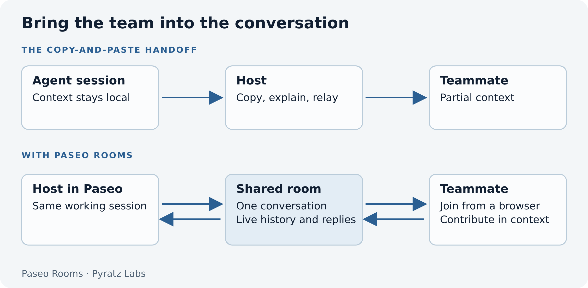
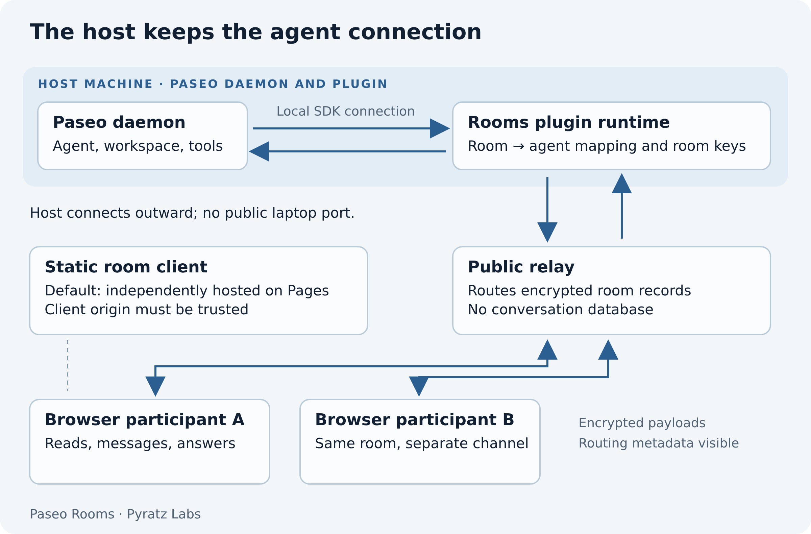
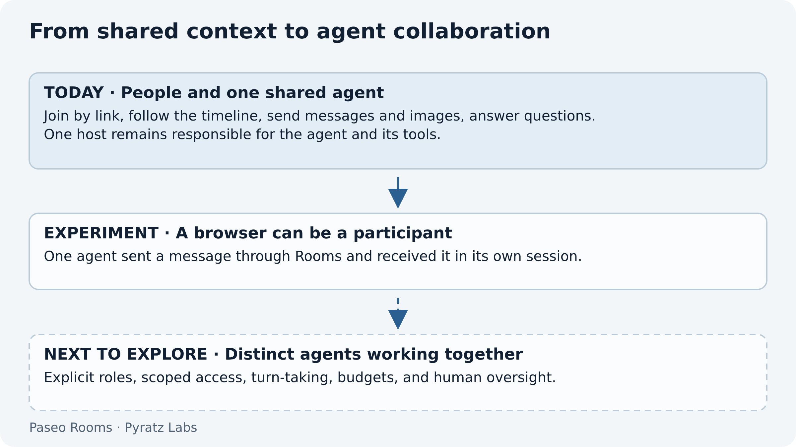

# Paseo Rooms: bring your team into the agent conversation

A developer is debugging with an agent, or working through an implementation plan, and needs a second opinion. They send me the problem. I take it to my own agent, work through it, and send an answer back. The developer then brings that answer into the original conversation.

We do this at Pyratz. It works, but context keeps crossing between people, tools, and agent sessions. A useful clarification can take several trips.

In the office, I can walk over to the developer's laptop and join the discussion. Remotely, we share a screen. That helps, but it also occupies their working environment. Even with two screens, they cannot always move on to something else while I investigate.

We wanted a way to join the conversation directly and let the developer keep working. That became [Paseo Rooms](https://paseo-rooms.pyratz.com/).

_One shared conversation removes the copy-and-paste handoff._

## A room around the work already in progress

The developer opens **Share session** in Paseo and creates a link. A teammate opens it in a browser, chooses a name, and joins the existing agent conversation. They can read its history, follow live replies, send a message or screenshot, and answer supported questions and approvals.

The developer can keep working while someone else investigates in the room. Both return to the same thread, with the agent's context still there.

This is also useful beyond the engineering team. We can invite a client into a room while shaping a plan, so they can answer business questions where those questions arise. “What should happen when a customer cancels?” is easier to resolve with the person who knows the business participating in the discussion. The team chooses a session whose contents and agent permissions are appropriate for that collaboration.

## Why we built it as a Paseo plugin

[Paseo](https://paseo.sh/) already gives us a place to run coding agents and follow their work. Its [plugin system](https://paseo.sh/docs/plugins) gave us a natural place for sharing: beside the session we wanted to discuss.

Rooms adds that panel and a host-side runtime. Through Paseo's official TypeScript SDK, it reads the selected agent's timeline, subscribes to live updates, and forwards room contributions. We did not need a second agent session with a reconstructed version of the problem.

The interaction we wanted was familiar from pair programming and shared documents: several people contributing in context. Our starting point was the friction in our own remote planning and debugging workflow.

_The host retains the agent connection; the relay routes room traffic._

## Who has to trust whom?

Room traffic is end-to-end encrypted between each participant's browser and the host-side Rooms runtime. The host creates a room keypair. The invitation carries its public key and an invite secret in the part of the URL after `#`, which is not sent in ordinary HTTP requests. The browser uses the expected host key to establish an encrypted channel, then proves it holds the invitation inside that channel. Each participant has a separate channel; the host fans replies out to everyone.

The relay forwards ciphertext. It can see routing identifiers, connection information, traffic sizes, and timing; it can also interrupt traffic. With a trusted browser client, it cannot read the messages or images inside those encrypted records. The host connects outward, so no public laptop port is needed.

**The frontend is part of the trust model.** Someone who controls the JavaScript served to a browser could change it to capture messages before encryption. Our default client is delivered separately on GitLab Pages, which separates its delivery from the relay but still requires trusting that client origin. Serving both from the relay's domain means trusting that operator for the page as well as routing. A maliciously altered client defeats the confidentiality claim.

Teams can host both pieces themselves. Deploy the relay and its bundled frontend under a domain you control, then select that relay and **Custom client** in the plugin. You can also serve the frontend from a separate static host you control. Either way, your organisation controls code delivery and routing; it still needs to trust its host machines, hosting administrators, and invited participants. The [self-hosting guide](https://paseo-rooms.pyratz.com/docs/how-to/run-your-own-relay) covers both arrangements.

The invitation is a bearer capability: anyone with the full link can join until it is revoked or the host process ends. Participants receive controls for one agent rather than a general daemon connection, but can influence the agent's tool use. A display name is not verified identity. The [security documentation](https://paseo-rooms.pyratz.com/docs/explanation/security-and-privacy) spells out those boundaries, including the lack of forward secrecy if a host room key is compromised.

## Next: agents as participants?

We tried a small experiment: an agent opened a room through a second browser client and sent a message back into its own session. The message arrived, and the agent replied. We stopped after one exchange.

That is a useful building block, rather than a demonstration of autonomous teamwork. The next question is whether distinct agents can use a shared room to exchange findings or challenge a plan, with people following the discussion.

_Agent-to-agent collaboration is a direction to explore, not a shipped coordinator._

Those experiments need explicit roles, bounded turns, clear authority, and stopping conditions. A reply loop is easy to create; a useful collaboration needs more structure.

For now, Rooms solves the problem we started with: bringing the right person into an agent conversation without tying up the developer's screen. Explore [Paseo Rooms](https://paseo-rooms.pyratz.com/) or follow the [first-room guide](https://paseo-rooms.pyratz.com/docs/tutorials/share-your-first-room) to try it with your team.
